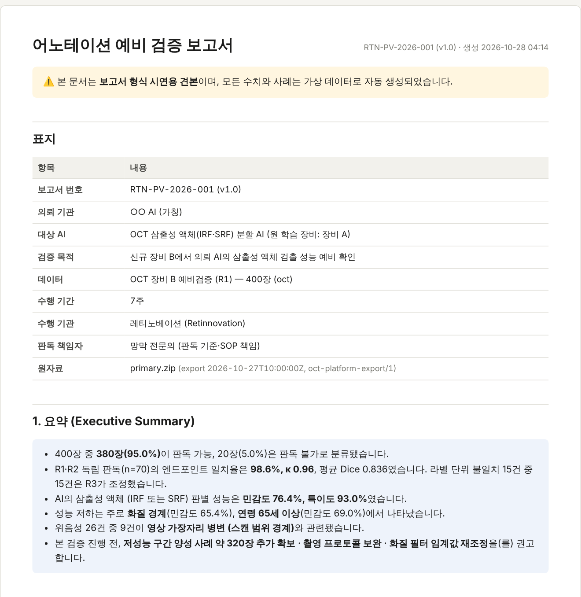
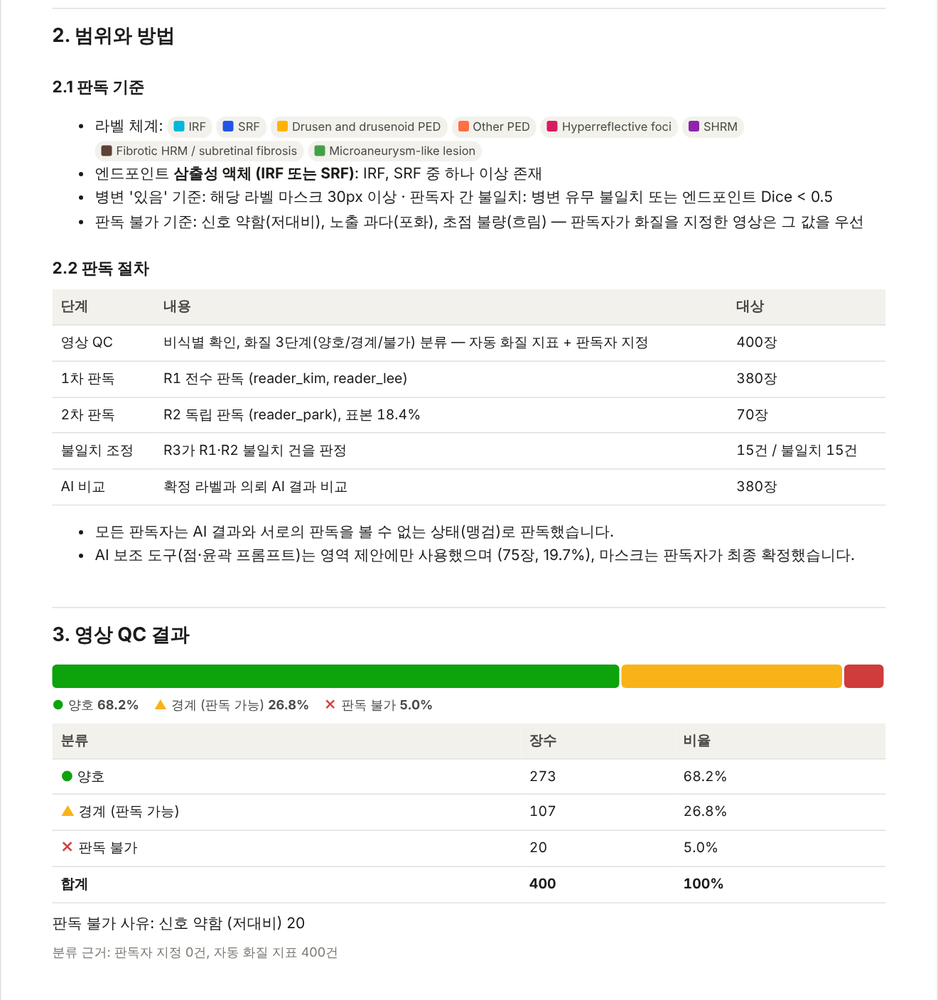
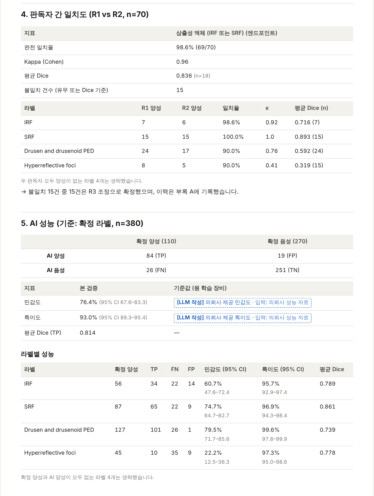
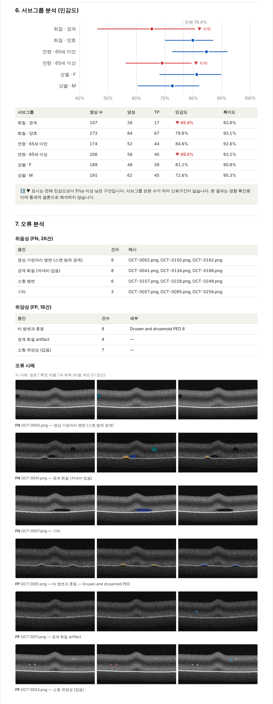
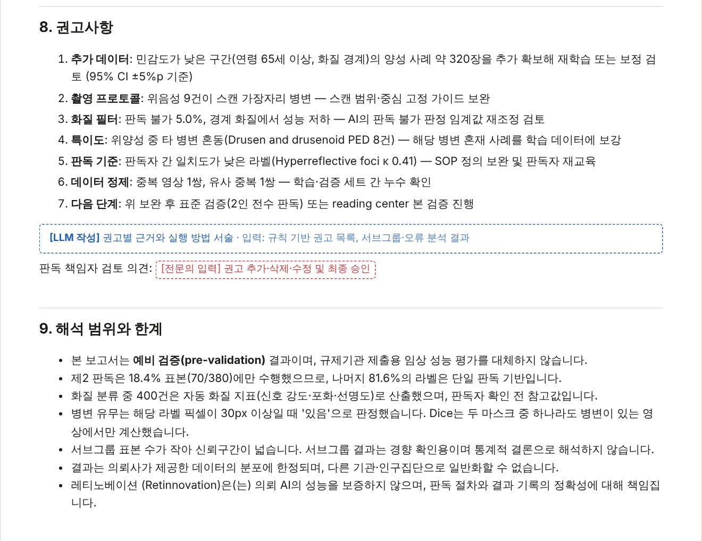
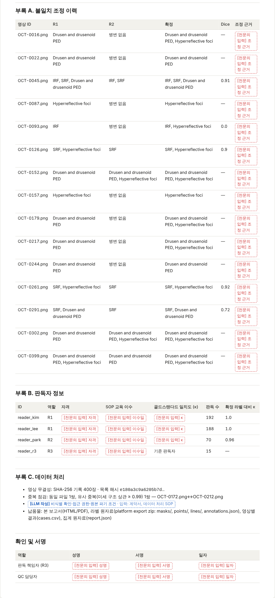
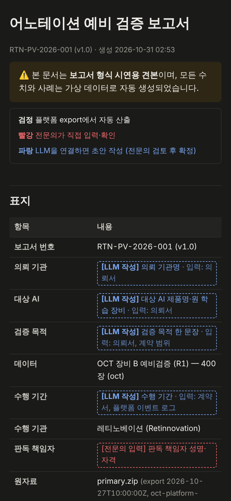

# 자동 어노테이션 보고서 (annotation_report)

`aws_annotator_platform`의 **Export zip**(Project → Export)을 읽어, Notion
「📄 Annotation 보고서 예시」 양식(2라운드 준비)의 **예비 검증(pre-validation) 보고서**를 자동으로 만듭니다.
플랫폼 코드는 바꾸지 않고, 플랫폼이 이미 내보내는 형식(`annotations.json` + `imgs/` + `masks/` + `points/`)만 사용합니다.

- 예시 보고서: [`examples/report.pdf`](examples/report.pdf) (A4, 10쪽) · [`examples/report.html`](examples/report.html) — HTML은 브라우저에서 인쇄 → PDF 저장
- 예시 화면: [`examples/screenshots/`](examples/screenshots/) (모든 수치는 가상 데이터)

| 화면 | |
|---|---|
| 표지·요약 |  |
| 범위와 방법·영상 QC |  |
| 판독자 간 일치도·AI 성능 |  |
| 서브그룹·오류 분석 |  |
| 권고사항·한계 |  |
| 부록 A–C |  |
| 모바일·다크 모드 |  |

## 실행

```bash
pip install -r annotation_report/requirements.txt      # numpy, Pillow
```

가상 데이터로 예시 보고서 만들기 (R1/R2/R3/AI export zip, meta.csv, report_config.json도 함께 생성):

```bash
python -m annotation_report demo --out demo_out
```

실제 프로젝트 보고서:

```bash
python -m annotation_report report --primary R1.zip --second R2.zip --adjudicated R3.zip --ai ai_pred --meta meta.csv --config report_config.json --out report_out
```

플랫폼 모델 서버(자동 분할)로 AI 예측 만들기:

```bash
python -m annotation_report predict --export R1.zip --model-url http://127.0.0.1:8100 --out ai_pred
```

결과물: `report.html`(보고서), `report.json`(모든 집계값), `cases.csv`(영상별 판정·Dice).

## 입력과 플랫폼 운영 방법

| 입력 | 플랫폼에서 만드는 법 | 보고서에서 쓰는 곳 |
|---|---|---|
| `--primary` (R1, 필수) | 1차 판독 프로젝트 → Export (submitted) | 전 영상, QC, 확정 라벨 기본값 |
| `--second` (R2) | 같은 영상 20% 표본을 별도 프로젝트에 올려 제2 판독자에게 배정 → Export | 4. 판독자 간 일치도, 부록 A |
| `--adjudicated` (R3) | 불일치 영상만 조정 프로젝트로 Import 후 책임 판독자가 수정, Review 노트에 근거 기록 → Export | 확정 라벨, 부록 A 조정 근거 |
| `--ai` | `predict` 명령, 또는 의뢰사 예측 마스크(`masks/<stem>.png`, 같은 label 값) | 5–7. AI 성능·서브그룹·오류 |
| `--meta` | CSV: `name`(영상 파일명) + 연령·성별·장비 등 열 | 6. 서브그룹 |
| `--config` | [`demo/report_config.json`](demo/report_config.json) 참고 | 표지, 엔드포인트, 기준값, 판독자 정보 |

영상은 이름 → 파일 stem → SHA-256 순으로 매칭하고, 마스크 값은 **라벨 이름**으로 R1 라벨 값에 다시 맞춥니다
(플랫폼 Import와 같은 방식이라 라벨 순서가 다른 프로젝트끼리도 비교됩니다).

## 보고서 항목과 계산 방법

| 섹션 | 계산 |
|---|---|
| 1. 요약 | 아래 결과에서 판독 가능 비율, 일치도, 민감도·특이도, 성능 저하 구간, 주요 위음성 원인, 권고를 문장으로 생성 |
| 2. 범위와 방법 | 라벨 체계·엔드포인트·판정 기준, 판독 절차 표(단계별 건수), AI 보조(점·윤곽 프롬프트) 사용 비율 |
| 3. 영상 QC | 판독자가 `image_quality` 텍스트 항목(양호/경계/판독 불가)을 입력했으면 그 값, 없으면 자동 화질 지표(신호 강도·포화·선명도) |
| 4. 판독자 간 일치도 | 라벨별 병변 유무(`min_lesion_px` 이상) 일치율, Cohen κ, 평균 Dice. 유무 불일치 또는 엔드포인트 Dice < 0.5 → 불일치 |
| 5. AI 성능 | 확정 라벨(R3, 없으면 R1) 대비 엔드포인트 혼동행렬, 민감도·특이도(Wilson 95% CI), 라벨별 성능·Dice, 의뢰사 기준값 비교 |
| 6. 서브그룹 | 화질 + `subgroups` 설정(연령 구간, 성별, 장비…)별 민감도. 전체보다 `flag_drop`(5%p) 이상 낮으면 ▼ 표시 |
| 7. 오류 분석 | FN: 스캔 가장자리 병변 → 경계 화질 → 소형 병변 → 기타. FP: 확정 라벨의 다른 병변과 겹침(예: 드루젠) → 경계 화질 → 소형 → 기타. 사례 이미지(원본 / 확정 / AI) 포함 |
| 8. 권고사항 | 규칙 기반: 저성능 구간 추가 확보 장수(95% CI ±5%p에 필요한 양성 수), 촬영 프로토콜, 화질 필터, 혼동 병변 보강, κ < 0.6 라벨 SOP 보완, 중복 정리 |
| 9. 해석 범위와 한계 | 단일 판독 비율, 자동 QC 사용 건수 등을 넣은 고정 문구 (보고서가 보증하는 것 / 보증하지 않는 것) |
| 부록 A–C | 불일치 조정 이력(R1·R2·확정·Review 노트), 판독자 정보(확정 라벨 대비 κ), 데이터 처리(SHA-256 목록 해시, 동일·유사 중복 영상) |

## 주의

- 자동 화질 기준값(`quality.thresholds`)은 가상 데이터로 맞춘 값입니다. 실제 장비 영상에서는 판독자 QC 결과와 비교해 다시 정해야 합니다.
- Notion 예시는 안저 DR 등급(분류)이지만 플랫폼은 OCT 분할이므로, 등급 대신 **라벨별 병변 유무 + Dice**로 같은 표를 채웁니다.
- 테스트: `python -m pytest annotation_report/tests`
